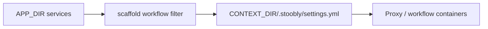

# `scaffold workflow filter`

## What it does

`stoobly-agent scaffold workflow filter` upserts **include** filter rules so intercepted traffic for selected service URL(s) is allowed for a workflow.

Service definitions (hostname, URL, workflow config) are read from the **app** scaffold. The resulting filter rules are written to the **context** `settings.yml` — the Stoobly data directory the proxy mounts and reads at runtime.

That split is intentional when `APP_DIR != CONTEXT_DIR`: one app can drive several contexts, and each context keeps its own proxy settings (including filter rules).

## Command

```bash
stoobly-agent scaffold workflow filter [OPTIONS] WORKFLOW_NAME
```

### Options

- `--app-dir-path TEXT` Path to application directory (scaffold / services).
- `--containerized` Set if run from within a container.
- `--context-dir-path TEXT` Path to Stoobly context directory (parent of `.stoobly`). Filter rules are applied to this context’s settings.
- `--service TEXT` Select specific services. Defaults to all services in the workflow (or the context’s `scaffold.services` list when set; see [context-dir-services.md](context-dir-services.md)).

## App vs context

| Concern | Source | Path |
|---------|--------|------|
| Service list, URL, workflow template | **App** | `APP_DIR/.stoobly/services/…` |
| Filter rules (and other proxy settings) | **Context** | `CONTEXT_DIR/.stoobly/settings.yml` |



1. Resolve the app scaffold (`--app-dir-path` / cwd walk-up).
2. Resolve the context (`--context-dir-path` / cwd `.stoobly` parent).
3. For each selected service, read URL and workflow template from the **app**.
4. Upsert include filter rules into the **context** settings for the matching filter mode.
5. Containers mount `CONTEXT_DIR/.stoobly`, so they pick up those rules.

## How filter rules are generated

For each selected service:

1. Skip if the service has no URL.
2. Resolve workflow template (`workflow` config `template`, else `WORKFLOW_NAME`).
3. Map that template to a filter mode (`workflow_template_to_filter_mode`).
4. Build an include rule for the service URL (`build_include_filter_rule_for_service_url`) with standard HTTP methods.
5. Upsert into the project’s filter-rule list and commit settings.

## Implementation note

`__services_filter` in `scaffold_cli.py` must load and commit settings for **`app.context_dir_path`**, not a cwd-only `Settings.instance()`. Otherwise, when the shell cwd is the app (or another directory) and `--context-dir-path` points elsewhere, rules can land in the wrong `settings.yml` while the proxy still reads the context mount.

## Examples

Filter all services in the `record` workflow for the current context:

```bash
stoobly-agent scaffold workflow filter record
```

From the app root, apply rules into a specific context:

```bash
stoobly-agent scaffold workflow filter \
  --app-dir-path ./app \
  --context-dir-path ./e2e \
  record
```

One service only:

```bash
stoobly-agent scaffold workflow filter \
  --app-dir-path ./app \
  --context-dir-path ./e2e \
  --service api \
  mock
```

## Related code

| File | Role |
|------|------|
| `stoobly_agent/app/cli/scaffold_cli.py` (`workflow filter`, `__services_filter`) | CLI entry; reads services from app, commits filter rules. |
| `stoobly_agent/app/cli/scaffold/workflow_filter.py` | Builds / upserts include filter rules. |
| `stoobly_agent/app/settings` | Persists `settings.yml` (must be the context data dir). |
| [context-dir-services.md](context-dir-services.md) | How `--context-dir-path` / `--service` defaults work. |
