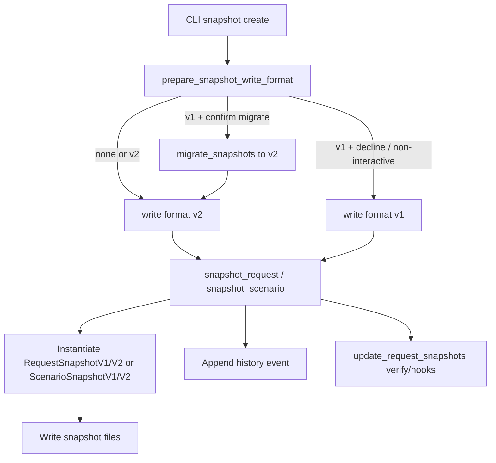
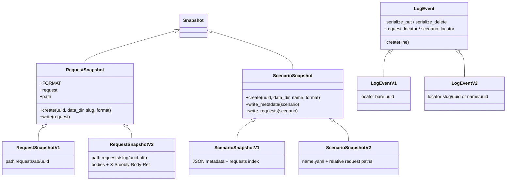

# Snapshot create

How `request snapshot create` and `scenario snapshot create` write snapshot files under `.stoobly/snapshots/` and append history events.

## Commands

```bash
stoobly-agent request snapshot create [--action PUT|DELETE] [--decode] <request_key>
stoobly-agent scenario snapshot create [--action PUT|DELETE] [--decode] <scenario_key>
```

Default `--action` is `PUT` (write/replace). `DELETE` removes snapshot files (when safe) and appends a delete event.

## High-level flow



1. CLI handler validates the key and loads the ORM request/scenario.
2. [`prepare_snapshot_write_format`](../stoobly_agent/app/cli/helpers/snapshot_format_prompt.py) detects format **once** and picks **v1** or **v2** (and may migrate).
3. Facade → model → [`snapshot_request`](../stoobly_agent/app/models/factories/resource/local_db/helpers/snapshot_service.py) / [`snapshot_scenario`](../stoobly_agent/app/models/factories/resource/local_db/helpers/snapshot_service.py) constructs the matching **V1/V2** class, writes files, and appends a log event with the **same** `format` (no second disk scan).
4. CLI runs [`update_request_snapshots`](../stoobly_agent/app/cli/helpers/update_request_snapshots_service.py) on the returned path (optional lifecycle hooks / verify). Prints request snapshot path(s).

## Class hierarchy

Format-specific path and I/O live in subclasses. Shared behavior (ORM adapters, backup/rollback helpers, metadata API) stays on the base.



| Role | How the class is chosen |
|------|-------------------------|
| **Create / delete write** ([`snapshot_service`](../stoobly_agent/app/models/factories/resource/local_db/helpers/snapshot_service.py)) | Instantiates `RequestSnapshotV1` / `RequestSnapshotV2` or `ScenarioSnapshotV1` / `ScenarioSnapshotV2` from the resolved write format |
| **History append** ([`Log.put` / `Log.delete`](../stoobly_agent/app/models/factories/resource/local_db/helpers/log.py)) | Same `format` from create is passed through; `LogEvent.serialize_*` picks `LogEventV1` / `LogEventV2` without re-detecting. `resolve_write_format` remains a fallback when `format` is omitted |
| **Read / apply / list / diff** | `RequestSnapshot.create(...)` / `ScenarioSnapshot.create(...)` detect from disk (and prefer V2 when a history locator includes a slug/name); `LogEvent.create(line)` picks V1/V2 from locator shape |
| **Type checks** | e.g. `isinstance(snapshot, RequestSnapshotV2)` instead of comparing a format flag |

## Format detection and write policy

Implemented in [`snapshot_format.py`](../stoobly_agent/app/models/factories/resource/local_db/helpers/snapshot_format.py).

| Detected on disk | Meaning |
|------------------|---------|
| **v2** | Any `requests/*/*.http` or `scenarios/*.yaml` |
| **v1** | Any `requests/<2-char>/<uuid>` (no `.http`) or extensionless `scenarios/<uuid>` |
| **none** | Empty / no recognizable snapshot files |

Write policy:

| Detected | Create writes |
|----------|----------------|
| none or v2 | **v2** (`*SnapshotV2`) |
| v1 | **v1** (`*SnapshotV1`), unless interactive create confirms migrate → then migrate tree and write **v2** |
| v1 + non-TTY / `--yes`-style non-interactive | stay on **v1** (no silent migrate) |

Readers always accept both formats via `.create()`.

## Request snapshot create (`PUT`)

Orchestration: [`snapshot_request`](../stoobly_agent/app/models/factories/resource/local_db/helpers/snapshot_service.py).

1. Resolve write format.
2. Construct `RequestSnapshotV2` (with slug from [`build_request_slug`](../stoobly_agent/app/models/factories/resource/local_db/helpers/request_slug.py)) or `RequestSnapshotV1`.
   - Slug: `{METHOD}-{path-with-/-as--}` (path only, no query). Example: `GET` + `/api/users/1` → `GET-api-users-1`.
3. Backup existing snapshot file (for rollback if log append fails).
4. `write(request)` — ORM → joined bytes via `JoinedRequestStringAdapter` (V2 externalizes bodies).
5. Append history event via `Log.put(request)`.
6. Return snapshot file path.

### v2 on-disk layout (`RequestSnapshotV2`)

```
.stoobly/snapshots/requests/<METHOD>-<path-slug>/
  <uuid>.http
  bodies/<sha256>
```

- `.http` is the existing joined control + raw HTTP request/response (monkey delimiter), **without** bodies.
- Non-empty bodies are written under `bodies/<content-hash>`.
- Last header on that HTTP message is `X-Stoobly-Body-Ref: bodies/<hash>` ([`body_ref.py`](../stoobly_agent/app/models/factories/resource/local_db/helpers/body_ref.py)).
- On read, bodies are reconstituted so apply/diff/list still see full joined bytes.

### v1 on-disk layout (`RequestSnapshotV1`)

```
.stoobly/snapshots/requests/<uuid[0:2]>/<uuid>
```

Single extensionless file of joined request+response with bodies inline.

### History line (request)

Space-delimited under `snapshots/history/`:

```
<event-uuid> request <locator> PUT <ms>
```

| Format | Class | `<locator>` |
|--------|-------|-------------|
| v2 | `LogEventV2` | `GET-api-users/<request-uuid>` |
| v1 / legacy | `LogEventV1` | `<request-uuid>` |

Apply passes the locator into `RequestSnapshot.create(...)` for O(1) path resolve; collapse/ORM identity is always the UUID suffix (`resource_id`).

## Scenario snapshot create (`PUT`)

Orchestration: [`snapshot_scenario`](../stoobly_agent/app/models/factories/resource/local_db/helpers/snapshot_service.py).

1. Resolve write format.
2. Construct `ScenarioSnapshotV2` (with scenario name) or `ScenarioSnapshotV1`.
3. Backup metadata (and later request payloads).
4. `write_metadata` / remove stale request snapshots (respecting shared refs via scenario inverted index) / `write_requests` (uses matching `RequestSnapshotV1` or `RequestSnapshotV2` for each request).
5. Append `Log.put(scenario)`.
6. Return metadata path.

### v2 on-disk layout (`ScenarioSnapshotV2`)

```
.stoobly/snapshots/scenarios/<sanitized-name>.yaml
.stoobly/snapshots/requests/<METHOD>-<path-slug>/
  <uuid>.http
  bodies/<sha256>
```

YAML fields:

```yaml
uuid: <scenario-uuid>
description: <str>
requests:
  - GET-api-users/<request-uuid>.http
```

Request entries are relative paths under `snapshots/requests/` (order preserved).

### v1 on-disk layout (`ScenarioSnapshotV1`)

```
.stoobly/snapshots/scenarios/<scenario-uuid>              # JSON {name, description}
.stoobly/snapshots/scenarios/requests/<scenario-uuid>     # newline-joined request UUIDs
.stoobly/snapshots/requests/<uuid[0:2]>/<uuid>            # request bodies
```

### History line (scenario)

```
<event-uuid> scenario <locator> PUT <ms>
```

| Format | Class | `<locator>` |
|--------|-------|-------------|
| v2 | `LogEventV2` | `<sanitized-name>/<scenario-uuid>` |
| v1 / legacy | `LogEventV1` | `<scenario-uuid>` |

## Delete action

`--action DELETE`:

- **Request:** remove file only if no scenario still references it; always append a DELETE history event.
- **Scenario:** remove its request snapshots (unless still referenced elsewhere), remove metadata, append DELETE history event.

Request snapshot backup/rollback still applies around the log append for request create.

## After create: verify / hooks

Both CLIs call `update_request_snapshots` with the written path and `with_snapshot=False` (does not append another history event). That path:

- Resolves request vs scenario from the file path and builds the matching V1/V2 snapshot via `.create(..., format=...)`.
- Optionally verifies/normalizes raw joined content (V2 always re-externalizes on rewrite).
- Optionally runs lifecycle hooks when `--lifecycle-hooks-path` is set.

## Related paths

| Path | Role |
|------|------|
| `snapshots/history/` | Append-only event shards |
| `snapshots/log` | Locked/committed event copy (gitignored) |
| `snapshots/VERSION` | Apply cursor (processed **event** UUIDs), not storage schema version |

Legacy `.uuid-index` dirs may exist under older v2 trees for uuid-only history lines; new creates rely on history locators instead. See also [snapshot migrate](snapshot-migrate.md).

## Key source files

| File | Role |
|------|------|
| [`request_cli.py`](../stoobly_agent/app/cli/request_cli.py) / [`scenario_cli.py`](../stoobly_agent/app/cli/scenario_cli.py) | CLI entrypoints |
| [`snapshot_format_prompt.py`](../stoobly_agent/app/cli/helpers/snapshot_format_prompt.py) | Migrate prompt + write format |
| [`snapshot_service.py`](../stoobly_agent/app/models/factories/resource/local_db/helpers/snapshot_service.py) | Create/delete orchestration; constructs V1/V2 classes |
| [`request_snapshot.py`](../stoobly_agent/app/models/factories/resource/local_db/helpers/request_snapshot.py) | `RequestSnapshot` + `RequestSnapshotV1` / `RequestSnapshotV2` |
| [`scenario_snapshot.py`](../stoobly_agent/app/models/factories/resource/local_db/helpers/scenario_snapshot.py) | `ScenarioSnapshot` + `ScenarioSnapshotV1` / `ScenarioSnapshotV2` |
| [`log_event.py`](../stoobly_agent/app/models/factories/resource/local_db/helpers/log_event.py) | `LogEvent` + `LogEventV1` / `LogEventV2` (locators); `.create()` / `.snapshot()` → snapshot `.create()` |
| [`body_ref.py`](../stoobly_agent/app/models/factories/resource/local_db/helpers/body_ref.py) | v2 body externalize/reconstitute |
| [`snapshot_migrate.py`](../stoobly_agent/app/models/factories/resource/local_db/helpers/snapshot_migrate.py) | v1 ↔ v2 migrate ([docs](snapshot-migrate.md)) |
