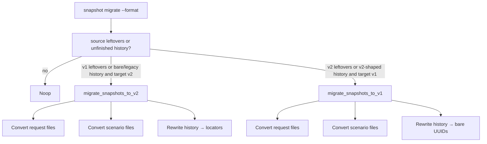

# Snapshot migrate

## Overview

`stoobly-agent snapshot migrate` converts on-disk request and scenario snapshots between **v1** and **v2** layouts. It also rewrites history/log locators so apply can resolve paths. `VERSION` is left untouched.

## CLI

```bash
stoobly-agent snapshot migrate --format v2
stoobly-agent snapshot migrate --format v1
```

| Option | Description |
|--------|-------------|
| `--format` | Required. Target format: `v1` or `v2`. |

### Outcomes

| Condition | Message |
|-----------|---------|
| No snapshots on disk | `No snapshots to migrate.` (noop) |
| Already at target format | `Snapshots are already in {v1\|v2} format.` (noop) |
| Conversion ran | `Migrated N request(s) and M scenario(s) to {v1\|v2}.` |

## Formats

| | **v1** | **v2** |
|---|--------|--------|
| Request file | `snapshots/requests/{uuid[0:2]}/{uuid}` (joined bytes, bodies inline) | `snapshots/requests/{slug}/{uuid}.http` (bodies under `bodies/` via `X-Stoobly-Body-Ref`) |
| Scenario metadata | `snapshots/scenarios/{uuid}` (JSON: `name`, `description`) | `snapshots/scenarios/{name}.yaml` (`uuid`, `description`, `requests`) |
| Scenario request index | `snapshots/scenarios/requests/{uuid}` (newline-separated UUIDs) | Listed in YAML as `slug/{uuid}.http` relative paths |
| History line | `uuid resource locator action [ms]` | `uuid ms action resource resource_id` (id last; spaces OK) |
| History locator | Bare UUID | Request: `slug/{uuid}`; scenario: `{name}/{uuid}` |

Detection ([`detect_snapshot_format`](../stoobly_agent/app/models/factories/resource/local_db/helpers/snapshot_format.py)): prefers v2 if any v2-shaped files exist; else v1; else none. Migrate gates on remaining source-format files (`has_v1_snapshots` / `has_v2_snapshots`) **or** unfinished history rewrite (target-format files exist but history still has source-shaped locators) so an interrupted run is finished rather than treated as already migrated.

Request slug: `{METHOD}-{path-with-slashes-as-dashes}` (root path → method only). See [`RequestSnapshotV2.build_request_slug`](../stoobly_agent/app/models/factories/resource/local_db/helpers/request_snapshot.py).

## Behavior



### v1 → v2

1. **Requests** — For each v1 shard file (`requests/{2-char}/{uuid}`):
   - Read joined bytes; derive method/path → slug.
   - Externalize bodies into `{slug}/bodies/` and write `{slug}/{uuid}.http`.
   - Remove the v1 file; drop empty shard dirs.
2. **Scenarios** — For each v1 metadata file (`scenarios/{uuid}`):
   - Load JSON name/description; map request UUIDs from `scenarios/requests/{uuid}` to relative `slug/{uuid}.http` paths.
   - Write `{sanitized-name}.yaml` (collision → `name-2.yaml`, …).
   - Remove v1 metadata and request-index files.
3. **History** — Rewrite bare UUID / stale `name/{uuid}` resource fields to `slug/{uuid}` (requests) / `{yaml-stem}/{uuid}` (scenarios) and re-order lines to `uuid ms action resource resource_id`. Canonical scenario stems come from the uuid→stem map (needed after collisions such as `dup-name-2`).

Corrupt request/scenario files are skipped and left in place.

### v2 → v1

1. **Requests** — For each `{slug}/{uuid}.http`:
   - Reconstitute inline bodies from `bodies/` refs.
   - Write `requests/{uuid[0:2]}/{uuid}`; remove `.http` and empty slug/`bodies` dirs.
2. **Scenarios** — For each `*.yaml` / `*.yml`:
   - Write JSON metadata at `scenarios/{uuid}` and UUID list at `scenarios/requests/{uuid}`.
   - Remove the YAML file.
3. **History** — Strip locators back to bare UUIDs and re-order lines to `uuid resource locator action [ms]`.

## History rewrite

Migrate does **not** append new log events. It updates the resource field on existing lines so apply can open the new paths:

| Direction | Request field | Scenario field |
|-----------|---------------|----------------|
| → v2 | `uuid` → `slug/uuid` | `uuid` or stale `name/uuid` → `{stem}/{uuid}` |
| → v1 | `slug/uuid` → `uuid` | `name/uuid` → `uuid` |

`VERSION` (processed event UUIDs) is unchanged. Event UUIDs and timestamps are unchanged.

Events whose snapshots were skipped (corrupt) keep bare UUIDs when migrating to v2; apply may still resolve via scan/fallback.

## Related paths

Migrate is also used interactively on **snapshot create** when v1 trees are detected: [`get_snapshot_format`](../stoobly_agent/app/cli/helpers/snapshot_format_service.py) can prompt and call `migrate_snapshots_to_v2` before writing.

## Implementation

| Piece | Location |
|-------|----------|
| CLI | [`snapshot_cli.py`](../stoobly_agent/app/cli/snapshot_cli.py) (`snapshot migrate`) |
| Core | [`snapshot_migrate.py`](../stoobly_agent/app/models/factories/resource/local_db/helpers/snapshot_migrate.py) |
| Format detect | [`snapshot_format.py`](../stoobly_agent/app/models/factories/resource/local_db/helpers/snapshot_format.py) |
| Snapshot classes | [`request_snapshot.py`](../stoobly_agent/app/models/factories/resource/local_db/helpers/request_snapshot.py) / [`scenario_snapshot.py`](../stoobly_agent/app/models/factories/resource/local_db/helpers/scenario_snapshot.py) (`*V1` / `*V2`; readers use `.create()`) |
| History events | [`log_event.py`](../stoobly_agent/app/models/factories/resource/local_db/helpers/log_event.py) (`LogEventV1` / `LogEventV2`; readers use `.create()`) |
| Body externalize / reconstitute | [`body_ref.py`](../stoobly_agent/app/models/factories/resource/local_db/helpers/body_ref.py) |
| OpenCLI contract | [`snapshot.opencli.yaml`](../stoobly_agent/app/cli/snapshot.opencli.yaml) |
| Create flow | [snapshot-create.md](snapshot-create.md) |
| Tests | [`snapshot_format_v2_test.py`](../stoobly_agent/test/app/cli/snapshot/snapshot_format_v2_test.py) |
