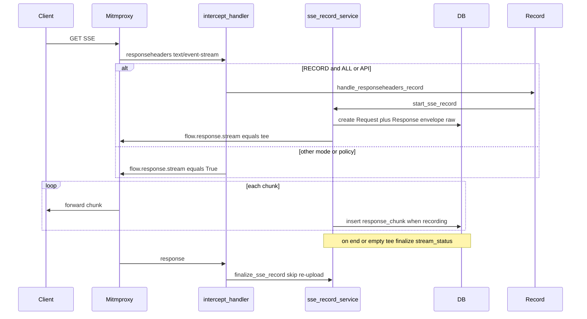
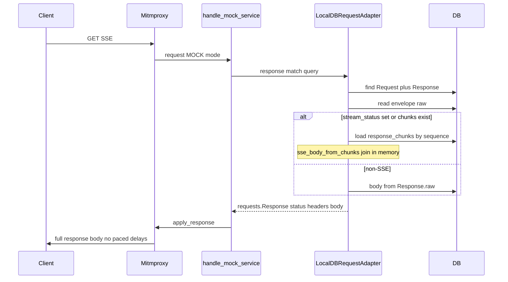
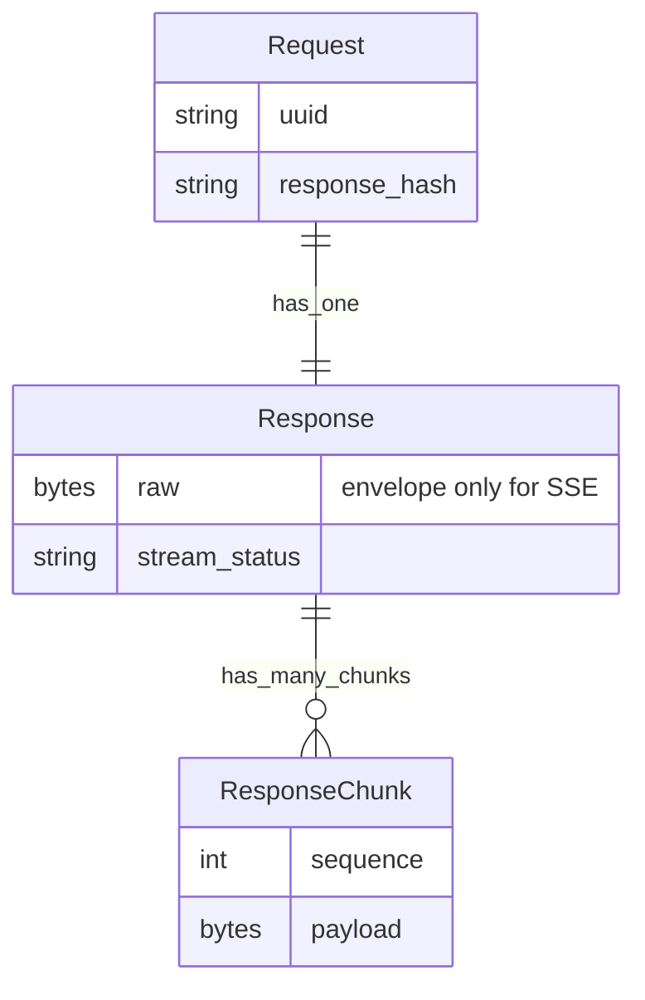

# SSE / streamed response handling

How Stoobly records, mocks, and snapshots **Server-Sent Events** (`Content-Type: text/event-stream`) without buffering the whole stream before the client sees it, and without folding chunk payloads into `Response.raw`.

## Background

One SSE connection is still **one HTTP response**: status + headers once, then a body delivered as discrete events over time. The stream may never end.

Stoobly therefore:

- Keeps `Request` **1:1** `Response` (envelope).
- Stores body fragments as `Response` **1:many** `response_chunks`.
- Leaves `Response.raw` as the **envelope only** (status line + headers, empty body) for the life of the record.
- Never concatenates chunk payloads into `raw` (in-memory join is used only for hashing / mock serving).

Detection: [`is_event_stream`](../stoobly_agent/app/proxy/replay/body_parser_service.py) on response `Content-Type` (`text/event-stream`, optional parameters ignored).

Non-SSE responses are unchanged: full body still lives in `Response.raw`.

---

## Record path

Hook: [`responseheaders`](../stoobly_agent/app/proxy/intercept_handler.py) (before the usual `response` hook).

**Tee:** a mitmproxy `flow.response.stream` callback (named after Unix `tee`) that takes each body chunk and both **forwards** it to the client and **persists** it as a `response_chunk` when recording. Setting `stream = True` alone streams to the client without recording. See [`_build_tee`](../stoobly_agent/app/proxy/record/sse_record_service.py).

### When recording starts

In **RECORD** mode, early create + tee run when record policy is:

| Policy | SSE recorded? |
|--------|----------------|
| `all` | Yes |
| `api` | Yes (`text/event-stream` is allowed alongside json/xml/text/plain) |
| `found` / `not_found` / `none` | No — client still gets streaming passthrough |

Implementation: [`handle_responseheaders_record`](../stoobly_agent/app/proxy/handle_record_service.py) → [`start_sse_record`](../stoobly_agent/app/proxy/record/sse_record_service.py).

### What is stored

| Field | SSE meaning |
|-------|-------------|
| `responses.raw` | Envelope only (status + headers). **Never** updated when chunks arrive. |
| `responses.stream_status` | `streaming` → `complete` or `capped` ([`stream_status`](../stoobly_agent/config/constants/stream_status.py)) |
| `response_chunks` | Ordered `sequence` + `payload` body fragments |
| `requests.response_hash` | Updated on finalize from concatenated chunk payloads **in memory** |

### Caps (never-ending streams)

From [`sse_record_service`](../stoobly_agent/app/proxy/record/sse_record_service.py):

- Max **10_000** chunks
- Max **10 MiB** total payload bytes

After a cap: further events are still **forwarded** to the client; persistence stops; `stream_status` becomes `capped`.

### `response` hook behavior

[`handle_response_record`](../stoobly_agent/app/proxy/handle_record_service.py) detects an SSE / already-started stream and:

- Calls `finalize_sse_record` (idempotent if the tee already finalized).
- Skips `disable_transfer_encoding` (that would force `Content-Length` and break open streams).
- Skips the normal buffer-then-upload path (no second create).

---

## Mock / replay path

[`LocalDBRequestAdapter.response`](../stoobly_agent/app/models/factories/resource/local_db/request_adapter.py):

1. Status / headers from envelope `Response.raw`.
2. If `stream_status` is set or chunks exist → body = ordered chunk payloads ([`sse_body_from_chunks`](../stoobly_agent/app/proxy/record/sse_record_service.py)).
3. No inter-event timing / paced replay (v1) — chunks are joined in memory and applied as one body via [`apply_response`](../stoobly_agent/app/proxy/utils/response_handler.py).

Joined-request decode ([`JoinedRequestStringAdapter.decode_response`](../stoobly_agent/app/models/adapters/orm/joined_request_string_adapter.py)) **skips** mutating `raw` when chunks / `stream_status` are present so snapshots keep envelope-only fidelity.

---

## Snapshots

SSE bodies are **not** represented only as `X-Stoobly-Body-Ref` (that would restore a concatenated body into `raw` and lose `response_chunks` on apply).

### Write

[`RequestSnapshotV2.build_entry` / `write`](../stoobly_agent/app/models/factories/resource/local_db/helpers/request_snapshot.py):

1. Externalize envelope headers as usual (`X-Stoobly-Header-Ref` when applicable).
2. Write chunk files under `.stoobly/snapshots/requests/<slug>/chunks/000000`, `000001`, …
3. Add **`X-Stoobly-Chunk-Ref: .stoobly/snapshots/requests/<slug>/chunks`** on the response headers ([`CHUNK_REF`](../stoobly_agent/config/constants/custom_headers.py), helpers in [`chunk_ref.py`](../stoobly_agent/app/models/factories/resource/local_db/helpers/chunk_ref.py)).

Real HTTP `Content-Type: text/event-stream` remains part of the response envelope (often under Header-Ref when on the dedup list).

### Apply / reconstitute

- [`reconstitute_joined_request`](../stoobly_agent/app/models/factories/resource/local_db/helpers/joined_request_ref.py) **strips** `X-Stoobly-Chunk-Ref` and does **not** inline chunk bytes into the HTTP body (envelope stays empty-bodied).
- After put/create, [`Apply.__apply_response_chunks`](../stoobly_agent/app/models/helpers/apply.py) reads the Chunk-Ref directory and recreates `response_chunks`, then sets `stream_status=complete`.

Copy/cleanup of snapshot dirs includes the `chunks/` folder alongside `bodies/` and `headers/`.

---

## Data model

Migrations:

- [`2026_11_26_000001_create_response_chunks`](../stoobly_agent/db/migrations/2026_11_26_000001_create_response_chunks.py)
- [`2026_11_26_000002_add_stream_status_column_to_responses`](../stoobly_agent/db/migrations/2026_11_26_000002_add_stream_status_column_to_responses.py)

---

## Out of scope (v1)

- Inter-event timing / paced mock replay
- Generic non-SSE streaming (chunked JSON, etc.) beyond `text/event-stream`
- Recording SSE under `found` / `not_found` policies at `responseheaders` time

---

## Key files

| Area | Path |
|------|------|
| Hooks | [`intercept_handler.py`](../stoobly_agent/app/proxy/intercept_handler.py) (`responseheaders`, `response`) |
| Record | [`sse_record_service.py`](../stoobly_agent/app/proxy/record/sse_record_service.py), [`handle_record_service.py`](../stoobly_agent/app/proxy/handle_record_service.py) |
| ORM | [`response.py`](../stoobly_agent/lib/orm/response.py), [`response_chunk.py`](../stoobly_agent/lib/orm/response_chunk.py) |
| Mock | [`request_adapter.py`](../stoobly_agent/app/models/factories/resource/local_db/request_adapter.py) |
| Snapshot refs | [`chunk_ref.py`](../stoobly_agent/app/models/factories/resource/local_db/helpers/chunk_ref.py), [`request_snapshot.py`](../stoobly_agent/app/models/factories/resource/local_db/helpers/request_snapshot.py) |
| Apply | [`apply.py`](../stoobly_agent/app/models/helpers/apply.py) |
| Test SSE upstream | [`sse_server.py`](../stoobly_agent/test/sse_server.py) (`python -m stoobly_agent.test.sse_server`) |
| Create flow | [snapshot-create.md](snapshot-create.md) |

